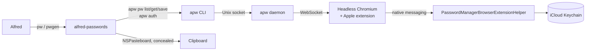

# Architecture

## Why apw

The macOS Passwords app exposes no API, and the `security` CLI only reads the
file-based login keychain, not iCloud Keychain. The only programmatic access is
`PasswordManagerBrowserExtensionHelper`, the native messaging host of Apple's
iCloud Passwords browser extension
(`/Library/Google/Chrome/NativeMessagingHosts/com.apple.passwordmanager.json`).

The helper carries a launch constraint: started by anything other than a
browser, macOS kills it with `SIGKILL (Code Signature Invalid)`, indicator
`Launch Constraint Violation`. A Rust client that speaks the helper's protocol
(length-prefixed JSON, SRP pairing, AES-GCM session) is therefore not an
option.

[apw](https://github.com/bendews/apw) works around it legitimately: its daemon
starts a headless Chromium with a copy of Apple's extension and a small bridge
script, and its CLI sends commands to the daemon over a Unix socket. The
cryptography stays in Apple's extension. This workflow uses apw's CLI, its
documented integration surface, rather than its socket.

## Components

A single binary, `alfred-passwords`, backs the Alfred graph:

| Subcommand | Alfred object | Role |
| --- | --- | --- |
| `search [query]` | Script Filter, keyword `pw` | Accounts for a domain, pairing items |
| `generate [query]` | Script Filter, keyword `pwgen` | Generate, optionally save |
| `run` | Run Script | Perform the picked item's action, print the notification |

Both script filters connect to the same Run Script, which connects to a Post
Notification. Extra connections carry the modifiers: ⌘ from `pw` (copy the
username) and ⌥ from `pwgen` (replace an existing password).

| Module | Responsibility |
| --- | --- |
| `query` | Parse `pw` / `pwgen` queries; normalise domains (`https://GitHub.com/login` → `github.com`) |
| `apw` | Run `apw`, decode its JSON results and failures into `ApwError` |
| `alfred` | Build `powerpack::Item`s from accounts, errors and queries |
| `actions` | Encode actions as Alfred variables, decode them, run them |
| `generator` | Apple-format password generation |
| `clipboard` | `Clipboard` trait; `SystemClipboard` writes to `NSPasteboard` |
| `runner` | `CommandRunner` trait; `SystemRunner` spawns processes with a timeout |

## Data flow

**Search** (`pw github.com work`): `query::parse_search` returns
`Domain { domain: "github.com", filter: "work" }` → `Apw::list_accounts` runs
`apw pw list github.com` → `alfred::accounts` keeps accounts whose username or
title contains every filter word and builds one item per account. Each item
carries the `copy-password` action in its variables, and its ⌘ modifier the
`copy-username` action. A query that is not a domain yet (no dot, or a
top-level domain under two letters) never calls apw, which keeps keystrokes
cheap.

**Generate** (`pwgen github.com me`): `query::parse_generate` returns
`Save { domain, username }` → `apw pw list` tells whether `me` already exists
→ `alfred::generate_and_save` builds either a "Generate and save" item, or an
invalid "Replace the password" item whose ⌥ modifier carries the action.

**Run**: Alfred exports the picked item's variables (`action`, `domain`,
`username`, `pin`) as environment variables → `Action::from_variables` decodes
them → `actions::run` fetches (`apw pw get`) or generates the password, saves
it when asked (`apw pw save --stdin`), writes it to the clipboard, and returns
the notification text that `main` prints.

**Pairing**: `pw pin` runs `apw auth request` (macOS shows a PIN), and
`pw pin 123456` runs `apw auth response --pin 123456`.

## Design decisions

- **Secrets stay out of Alfred.** Items carry the domain and username, never
  the password. The `run` action fetches or generates it and writes it to the
  clipboard itself, so it does not appear in Alfred's debugger, variables, or
  clipboard history.
- **Concealed clipboard entries.** `SystemClipboard` writes the
  `org.nspasteboard.ConcealedType` type next to the text, the convention
  clipboard managers follow to skip an entry. Usernames are not concealed.
- **Password on stdin.** `apw pw save --stdin` receives the password on stdin,
  never in `argv`, which other processes can read.
- **Errors are items.** Script filters never fail: an apw failure becomes an
  item that says how to fix it (install, start the daemon, pair). The `run`
  action prints its failures for the notification.
- **No `uid`.** Alfred would re-sort items by usage; the order is deliberate.
- **Timeouts.** Every apw call is bounded (`Apw::TIMEOUT`, 30 s, enough for a
  Touch ID prompt); a hung apw is killed and reported.
- **apw status codes.** `3` is "no results" (an empty list, not an error).
  `9` is an invalid session: the error text `unpaired` means the daemon runs
  but is not paired; anything else means it is unreachable.
- **Testability.** The two side effects (spawning apw, writing the clipboard)
  sit behind traits. Tests inject `FakeRunner` and `FakeClipboard`
  (`tests/common/mod.rs`); `SystemRunner` is tested against throwaway shell
  scripts.
