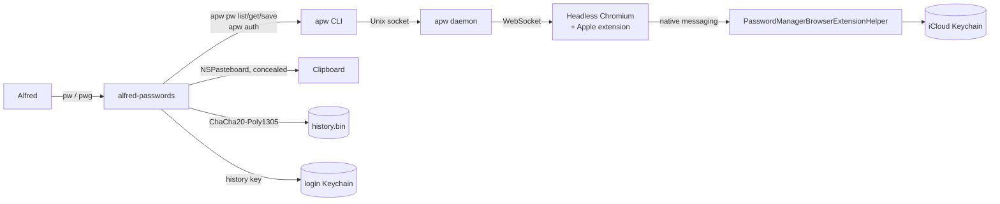

# Architecture

## Why apw

The macOS Passwords app exposes no API, and the `security` CLI only reads the
file-based login keychain, not iCloud Keychain. The only programmatic access is
`PasswordManagerBrowserExtensionHelper`, the native messaging host of Apple's
iCloud Passwords browser extension
(`/Library/Google/Chrome/NativeMessagingHosts/com.apple.passwordmanager.json`).

The helper carries a launch constraint: started by anything other than a
browser, macOS kills it with `SIGKILL (Code Signature Invalid)`, indicator
`Launch Constraint Violation`. A Rust client that speaks the helper's protocol
(length-prefixed JSON, SRP pairing, AES-GCM session) is therefore not an
option.

[apw](https://github.com/bendews/apw) works around it legitimately: its daemon
starts a headless Chromium with a copy of Apple's extension and a small bridge
script, and its CLI sends commands to the daemon over a Unix socket. The
cryptography stays in Apple's extension. This workflow uses apw's CLI, its
documented integration surface, rather than its socket.

## Components

A single binary, `alfred-passwords`, backs the Alfred graph:

| Subcommand | Alfred object | Role |
| --- | --- | --- |
| `search [query]` | Script Filter, keyword `pw` | Accounts for a domain, pairing items |
| `generate [query]` | Script Filter, keyword `pwg` | Generate with the configured or typed options, optionally save; list the last generated passwords |
| `run` | Run Script | Perform the picked item's action, print the notification |

Both script filters connect to the same Run Script, which connects to a Post
Notification. Extra connections carry the modifiers: ⌘ from `pw` (copy the
username) and ⌥ from `pwg` (replace an existing password).

| Module | Responsibility |
| --- | --- |
| `query` | Parse `pw` / `pwg` queries and `pwg` options; normalise domains (`https://GitHub.com/login` → `github.com`) |
| `apw` | Run `apw`, decode its JSON results and failures into `ApwError` |
| `alfred` | Build `powerpack::Item`s from accounts, errors and queries |
| `actions` | Encode actions as Alfred variables, decode them, run them |
| `domains` | Local index of looked-up domains (`domains.json`), ranked by frecency for autocompletion |
| `generator` | Password styles (Apple, custom rules), their spec and summary, the workflow configuration, generation |
| `history` | The last 20 generated passwords: cap, masked preview, age |
| `vault` | `HistoryVault` / `KeyStore` traits; `EncryptedFile` (ChaCha20-Poly1305), `KeychainKeyStore` |
| `clipboard` | `Clipboard` trait; `SystemClipboard` writes to `NSPasteboard` |
| `runner` | `CommandRunner` trait; `SystemRunner` spawns processes with a timeout |

## Data flow

**Search** (`pw github.com work`): `query::parse_search` returns
`Domain { domain: "github.com", filter: "work" }` → `Apw::list_accounts` runs
`apw pw list github.com` → `alfred::accounts` keeps accounts whose username or
title contains every filter word and builds one item per account. Each item
carries the `copy-password` action in its variables, and its ⌘ modifier the
`copy-username` action. A query that is not a domain yet (no dot, or a
top-level domain under two letters) never calls apw, which keeps keystrokes
cheap.

**Domain index**: the helper cannot list every account, only the accounts of
one exact domain, so autocompletion relies on what the workflow has already
seen. `DomainIndex` lives in `domains.json` under Alfred's
`alfred_workflow_data` folder and holds, per domain, a use count and the last
time it was seen.

- A lookup that returns accounts adds the domain (`DomainIndex::observe`); one
  that returns none removes it, so a mistyped or emptied domain disappears. A
  failed lookup (daemon down) changes nothing. The file is only rewritten when
  the index changes, not on every keystroke.
- A successful `run` on an account (copy, save) counts one use of its domain
  (`record_use`).
- `pw` alone, and a query that is not a domain yet, list the known domains
  containing the input (`suggest`): label prefixes first (`hub` ranks
  `hub.docker.com` above `github.com`), then by frecency, `(uses + 1)` halved
  every 30 days. A complete domain without accounts (`github.co`) also lists
  the known domains containing it, above the "No account found" item.
- Suggestion items are invalid with an `autocomplete` of `"<domain> "`, so ↵ or
  ⇥ completes the query and triggers the lookup.

**Generate** (`pwg 24 -s github.com me`): `query::parse_generate` reads the
options wherever they are (`24`, `-s`) and returns
`Target::Save { domain, username }` → `Options::apply` turns the options and
the workflow configuration (`Config::from_vars`, the `PWG_*` variables) into a
`Style` → `apw pw list` tells whether `me` already exists →
`alfred::generate_and_save` builds either a "Generate and save" item, or an
invalid "Replace the password" item whose ⌥ modifier carries the action. The
style travels in the item's `style` variable as a spec (`apple`, or
`custom:<length>:<flags>` with `l`, `d`, `s`, `a`), so the action generates
exactly what the subtitle announced. Without a username, `pwg` also lists the
history (newest first).

**Styles**: `Style::Apple` is three groups of six lowercase letters with one
uppercase letter and one digit, without `i l o 0 1`. `Style::Custom` draws
from the enabled sets (letters `a-zA-Z`, digits, symbols `@&$!#?`), removing
look-alikes (`1lI|O0oZ2`) unless allowed; one character of each enabled set is
placed first, the rest is drawn from all of them, then everything is shuffled
(Fisher-Yates). Every draw is a uniform value from `getrandom`, by rejection
sampling. Options: a number sets the length (4–40), `apple` picks the Apple
format, `±l ±d ±s ±a` toggle a set. A length or a toggle means a custom
password based on the configured rules, even when the configured style is
Apple; invalid options become invalid items listed first.

**History**: every password generated by `run` (`generate`,
`generate-and-save`) is pushed to `History` (newest first, 20 at most) with
its time, its style summary and, when saved, the account. It is stored by
`EncryptedFile` in `history.bin` under `alfred_workflow_data`: `APH1` magic,
12-byte random nonce, ChaCha20-Poly1305 ciphertext of the JSON, the magic as
associated data; written atomically with mode 0600. The 256-bit key is a
generic password in the login Keychain (`io.github.pdegeeter.alfred-passwords`
/ `history-key`), created on first use by `KeychainKeyStore` through the
Security framework. History items show `History::preview` (four characters
and a fixed `****`) and carry only the entry's random id; `copy-generated`
looks the password up again in the decrypted history.

**Run**: Alfred exports the picked item's variables (`action`, `domain`,
`username`, `pin`, `style`, `id`) as environment variables → `Action::from_variables` decodes
them → `actions::run` fetches (`apw pw get`) or generates the password, saves
it when asked (`apw pw save --stdin`), writes it to the clipboard, and returns
the notification text that `main` prints.

**Pairing**: `pw pin` runs `apw auth request` (macOS shows a PIN), and
`pw pin 123456` runs `apw auth response --pin 123456`.

## Design decisions

- **Secrets stay out of Alfred.** Items carry the domain and username, never
  the password. The `run` action fetches or generates it and writes it to the
  clipboard itself, so it does not appear in Alfred's debugger, variables, or
  clipboard history.
- **Concealed clipboard entries.** `SystemClipboard` writes the
  `org.nspasteboard.ConcealedType` type next to the text, the convention
  clipboard managers follow to skip an entry. Usernames are not concealed.
- **Password on stdin.** `apw pw save --stdin` receives the password on stdin,
  never in `argv`, which other processes can read.
- **Errors are items.** Script filters never fail: an apw failure becomes an
  item that says how to fix it (install, start the daemon, pair). The `run`
  action prints its failures for the notification.
- **No `uid`.** Alfred would re-sort items by usage; the order is deliberate.
- **The index stores domains only.** Usernames would make suggestions one
  step shorter but would leave identifiers in clear on disk. A missing or
  malformed `domains.json` is an empty index, and a failure to save it only
  goes to Alfred's debugger: suggestions are best-effort.
- **History encrypted, key in the Keychain.** A key typed in Configure
  Workflow would sit in clear in the workflow's `prefs.plist`, often synced
  with Alfred's preferences, next to what it protects. A random key in the
  Keychain protects backups and synced copies of `history.bin`. The cost: the
  binary is not signed, so macOS asks to allow Keychain access again after
  each update. It does not protect against code running as the user, which
  can ask the Keychain too.
- **The history never blocks a copy.** The password is copied first; if the
  history cannot be saved (Keychain access denied), the notification says so.
  A history that can no longer be decrypted (key deleted, file corrupt) is
  replaced; a denied Keychain is reported, never overwritten. A missing
  `history.bin` is an empty history and does not touch the Keychain.
- **Timeouts.** Every apw call is bounded (`Apw::TIMEOUT`, 30 s, enough for a
  Touch ID prompt); a hung apw is killed and reported.
- **apw status codes.** `3` is "no results" (an empty list, not an error).
  `9` is an invalid session: the error text `unpaired` means the daemon runs
  but is not paired; anything else means it is unreachable.
- **Testability.** The side effects (spawning apw, writing the clipboard,
  the Keychain, the history storage) sit behind traits. Tests inject
  `FakeRunner`, `FakeClipboard`, `FakeKeyStore` and `FakeVault`
  (`tests/common/mod.rs`); `SystemRunner` is tested against throwaway shell
  scripts and `EncryptedFile` against temporary files with a fake key.
